# Architecture

> Diagrams use [Mermaid](https://mermaid.js.org/). They render on GitHub/GitLab and in VS Code's
> Markdown preview (install the "Markdown Preview Mermaid Support" extension if needed).

## 1. Style
- **Modular monolith**: one deployable, with modules split by bounded context. It's simpler to build,
  test and demo than microservices. A context can be extracted later because contexts only talk
  through ports.
- **Clean Architecture per context**: `api → application → domain ← infrastructure`.
- **DDD tactical patterns**: value objects, aggregates, repositories, domain services.
- **Dependency injection**: FastAPI `Depends` + one composition root (`app/container.py`).

### System view

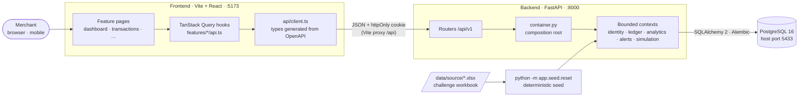

## 2. Bounded contexts

| Context | Type | Owns | Key objects |
|---|---|---|---|
| identity | supporting | users, merchant access, profile | `User`, `Merchant`, `ResolveScope` → `MerchantScope` |
| ledger | core | transactions, imports, provenance | `Transaction` (immutable), `ImportBatch`, `ImportTransactions` |
| analytics | core | KPIs, collections, comparisons | `compute_kpis`, `collection_series`, `compare`, `GetDashboard` |
| alerts | core | rules, alert lifecycle | `Alert` aggregate, `AlertRule` strategies |
| simulation | core | growth what-if | `Baseline`, `Assumptions`, `simulate` |
| loyalty | supporting | hypothetical programme versions, offer simulator, pilot points ledger | `ProgramRules`, `simulate`, `break_even`, `plan_accrual`, `LedgerEntry` |
| customers | supporting | pseudonymous customer analytics, win-back decisions (reads ledger via `TransactionReader`) | `build_book`, `CustomerProfile`, `return_status`, `reengagement_list`, `RecordDecision` |

### Context map
Arrows mean "depends on". Analytics and alerts *conform* to the ledger's published `Transaction`
model (read only). Nothing depends on alerts or simulation, so they can be built in parallel.

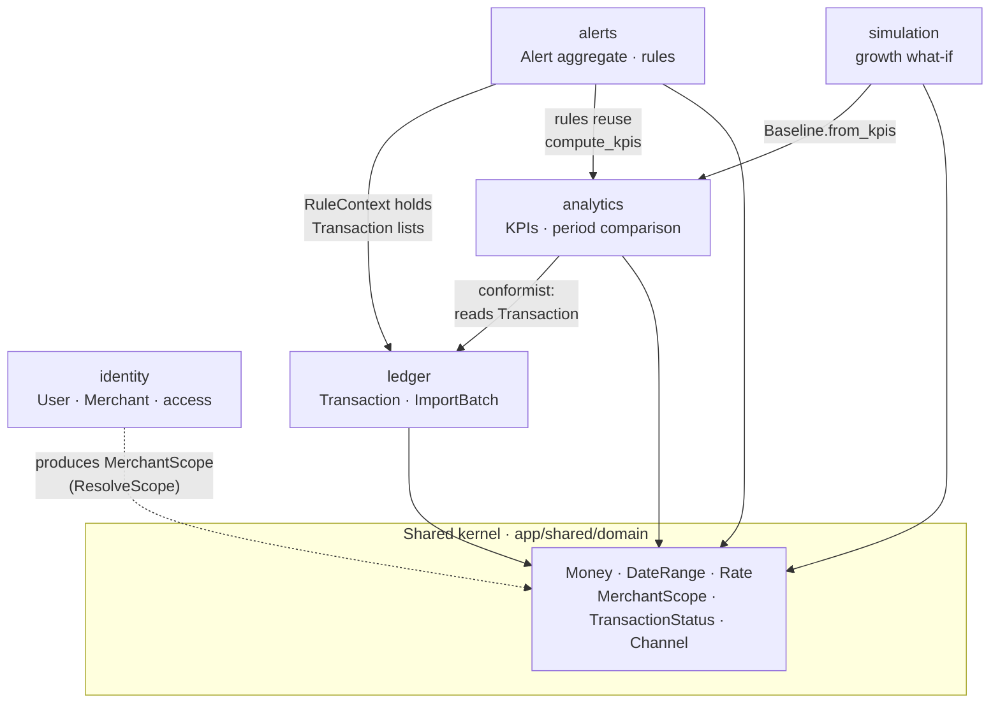

## 3. The dependency rule (non-negotiable)

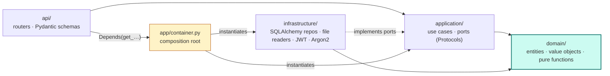

The domain is in the centre and imports nothing framework-related. Only `container.py` knows
which concrete adapter backs each port.

| Layer | May import | Must NOT import |
|---|---|---|
| `domain/` | `app.shared.domain`, other contexts' `domain` | FastAPI, SQLAlchemy, Pydantic, `app.db` |
| `application/` | `domain`, its own `ports.py` | FastAPI, SQLAlchemy |
| `infrastructure/` | everything above + SQLAlchemy, `app.db.models` | `api/` |
| `api/` | `application`, `app.container`, Pydantic | `infrastructure` directly (go through `container.py`) |

Quick check: `grep -rn "sqlalchemy\|fastapi" src/backend/app/contexts/*/domain` must return nothing.

## 4. Shared kernel (`app/shared/domain`)

| Value object | Why it exists |
|---|---|
| `Money` | integer centimes, DZD. Makes float rounding bugs impossible |
| `DateRange` | half-open `[start, end)`. `previous()` gives the like-for-like prior period |
| `Rate` | keeps numerator and denominator together. `value` is `None` when the denominator is 0 |
| `MerchantScope` | authorized tenant. **Every repository read takes it as the first argument** |
| `TransactionStatus` / `Channel` | enums with tolerant EN/FR parsing. `is_collected` is true only for Accepted |

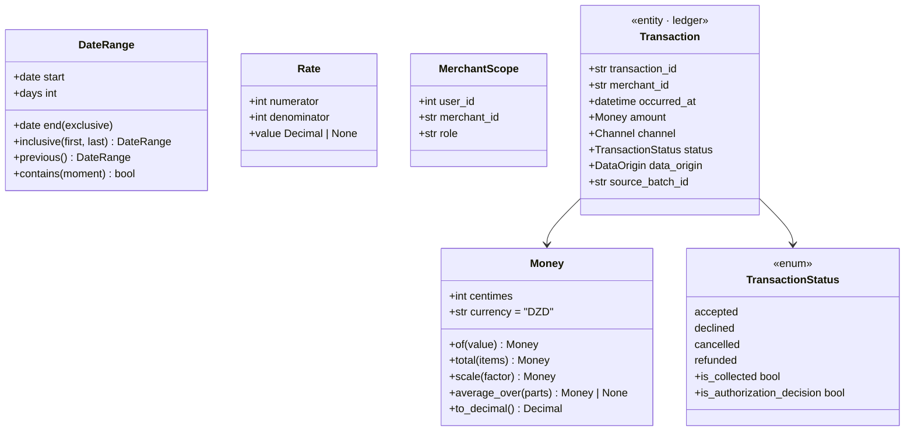

## 5. Tenant isolation
`get_scope` (in `container.py`) reads the session cookie, then `ResolveScope` loads the user's
grants from `user_merchant_access`. An optional `X-Merchant-Id` header can select among the
user's *own* merchants; anything else returns 403. Repositories filter by `scope.merchant_id`,
so a transaction belonging to another merchant returns **404**, which doesn't reveal that it exists.
Integration tests cover both cases.

### One request, end to end: `GET /api/v1/analytics/dashboard`

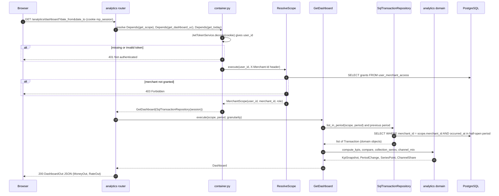

## 6. Dependency injection

### Ports and adapters
Use cases depend on **Protocols** (ports). One SQL adapter implements several ports through
structural typing, and tests use in-memory fakes in its place.

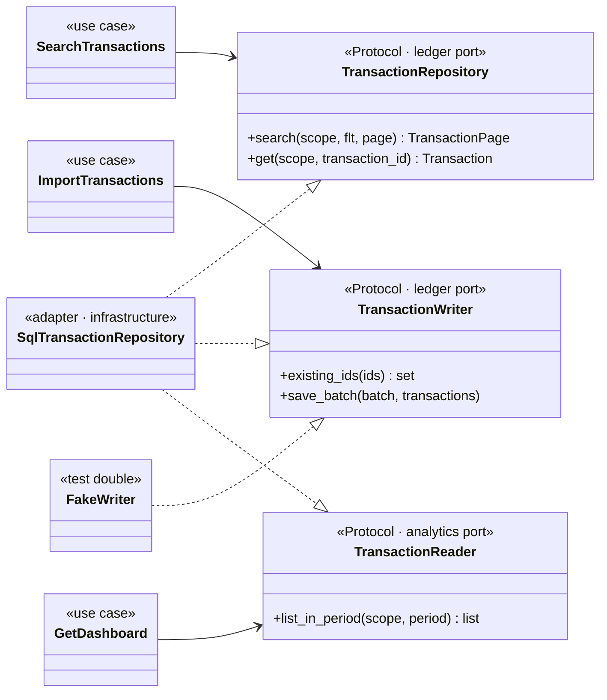

```python
# container.py: the only place that knows concrete classes
def get_transaction_repository(db=Depends(get_db)) -> SqlTransactionRepository: ...
def get_dashboard_uc(repo=Depends(get_transaction_repository)) -> GetDashboard:
    return GetDashboard(repo)          # analytics port <- ledger adapter

# router
def dashboard(scope=Depends(get_scope), uc: GetDashboard = Depends(get_dashboard_uc)): ...

# tests
app.dependency_overrides[get_today] = lambda: date(2026, 11, 20)
```

`get_today` is an injectable clock, so the demo and tests are reproducible.

## 7. Data model

The full schema is created by the first migration (`a21993cae9cd`), including the tables the team
has not wired yet (alerts, scenario runs, audit events). The seven original source fields live
unchanged in `transactions`; `data_origin` and `source_batch_id` are provenance metadata.

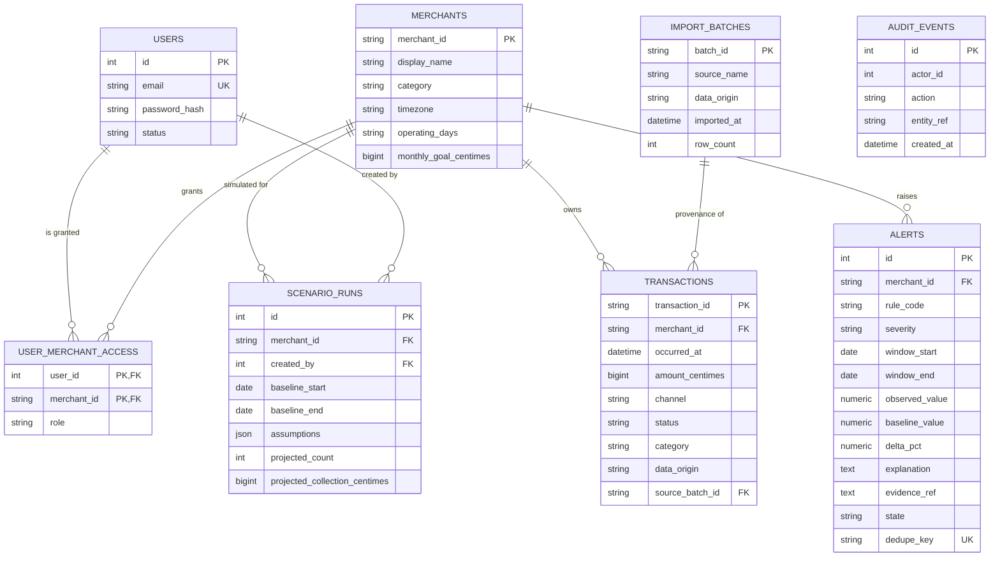

`transactions` has a composite index on `(merchant_id, occurred_at)`, which serves every scoped,
period-filtered query.

## 8. Key flows

### Import pipeline (workbook and synthetic seed share it)

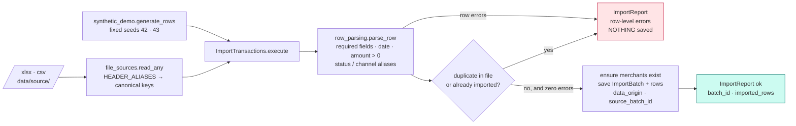

The import is all-or-nothing: if any row fails, the whole batch is rejected with a report, so no
data is ever silently corrupted.

### Alert lifecycle (`Alert` aggregate)

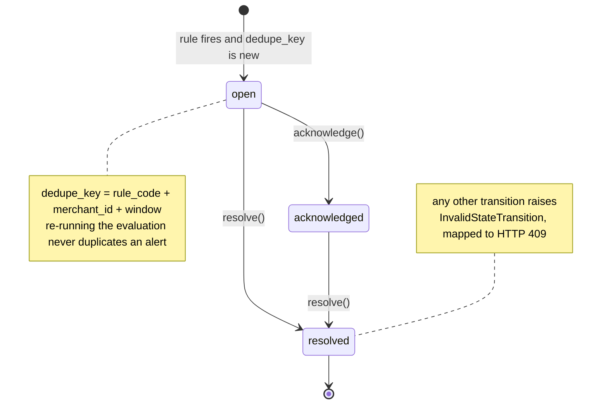

### Alert evaluation (Strategy pattern, part of the team plan)

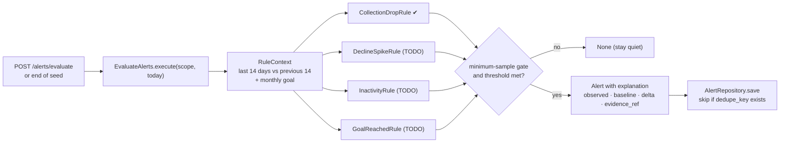

## 9. Frontend structure

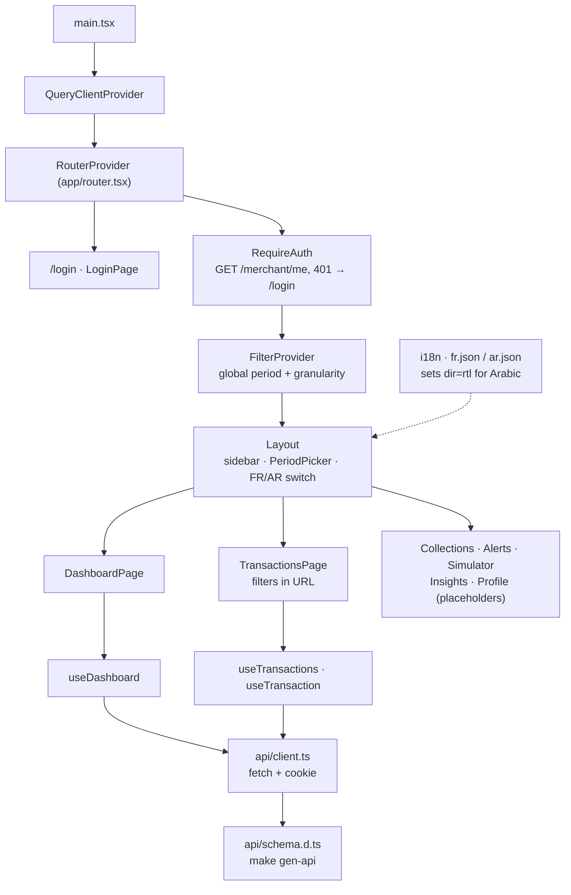

- Server state lives in TanStack Query (no global store). The only client state is the shared
  period filter, plus ledger filters kept in the URL so dashboards and alerts can deep-link
  (`/transactions?status=declined&channel=ecommerce`).
- The frontend never does money arithmetic: it formats the `MoneyOut.amount` string it receives.

## 10. Recipes

### Add an endpoint (example: `GET /collections/summary`)
1. **Domain**: pure function(s) in `analytics/domain/` (reuse `compute_kpis`, `compare`). Add unit tests.
2. **Application**: use case class in `analytics/application/`, taking ports in `__init__`.
3. **Container**: a `get_<use_case>` provider in `app/container.py`.
4. **API**: a Pydantic response model and route in `analytics/api/router.py`, with `scope=Depends(get_scope)`.
5. Wire the router in `app/main.py` if it's a new context.
6. Run `make gen-api`, then use the new type in the frontend.
7. Add an integration test for scoping plus one for the happy path.

### Add an alert rule
1. Create a class in `alerts/domain/rules.py` with `code` and `evaluate(ctx) -> Alert | None`.
2. Include a minimum-sample gate and a human-readable `explanation` (metric, windows, threshold, values).
3. Add it to `DEFAULT_RULES`. No other code changes.
4. Write unit tests: one that fires, one that stays quiet, and one with a small sample.

### Change the schema
Edit `app/db/models.py`, run `cd src/backend && uv run alembic revision --autogenerate -m "..."`,
review the file, and commit it. **Only one person creates migrations at a time** (tell your teammate).

## 11. Deliberately NOT built (and why)
| Pattern | Reason for skipping it during the hackathon |
|---|---|
| Unit of Work abstraction | one SQLAlchemy session per request is already a unit of work |
| Domain event bus | alert evaluation is called directly after import or on demand |
| Generic base repository | explicit, scoped methods make tenant isolation easier to review |
| Microservices | no workload justifies them, and they'd add deployment risk |
| Deep learning / fraud model | 150 rows, no labels (see blueprint §3 and §7) |
